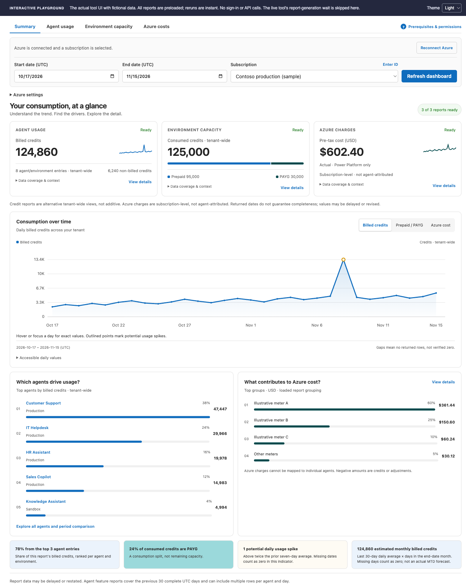

# Copilot Studio Cost & Usage Analyzer

Review Copilot Studio agent credit consumption and environment capacity from Power Platform licensing reports, and related monetary charges from Azure Cost Management. The tool requests data directly from the Power Platform API and, through PPTB's Azure API, Azure Resource Manager—there are no report files to download, upload, or import, and no separate sync flow to set up.

Select **Prerequisites & permissions** in the tool header at any time to see a live checklist of what is ready, missing, denied, or not yet verified, plus a reference of what an administrator needs to provision.

## Interactive playground

[](https://powermaverick.dev/demos/copilot-studio-cost-analyzer/)

Try the [interactive playground](https://powermaverick.dev/demos/copilot-studio-cost-analyzer/) before connecting a tenant—no installation or sign-in required. Explore **Summary**, **Agent usage**, **Environment capacity**, and **Azure costs**, including filters, charts, potential spikes, drill-downs, and CSV exports.

All reports are preloaded with fictional data, and refreshes return instantly. The demo does not access tenant data or call reporting APIs; real reports require the permissions below and may take time to generate.

## Before you start

For the Power Platform credit reports, make sure all of the following are true. Azure costs have their own prerequisites below:

1. **Use Power Platform ToolBox 1.2.9 or later.** The tool uses the Power Platform API's raw-response methods to follow the report-generation workflow and download its compressed report.
2. **Have an active PPTB connection.** In the connection settings, enable **Power Platform API** for that connection. Select or activate this connection before opening the tool.
3. **Sign in as a user.** The reports API requires a delegated Microsoft Entra sign-in. App-only/service-principal authentication is not supported for these reports.
4. **Have a required administrator role in the tenant.** The account must hold at least one of:
   - Global Administrator
   - Power Platform Administrator
   - Dynamics 365 Administrator
5. **Check tenant availability.** The API is enabled per tenant and the initial documented availability is for tenants whose home geo is North America (NAM). Report types and JSON output may also depend on tenant rollout and data readiness.

PPTB manages sign-in and token renewal. The tool does not ask you to paste a token or app secret.

### App registration and permissions

Configure the **Microsoft Entra app registration whose client ID is used by your PPTB connection**, not an individual Copilot Studio agent's app registration. Enabling an API in PPTB or declaring it in the tool manifest does not grant Microsoft Entra permissions, tenant roles, or Azure RBAC.

| API | Why the tool uses it | App registration / token requirement | Additional authorization |
|---|---|---|---|
| **Power Platform API (`pp`)** | Agent usage and environment capacity credit reports | Delegated user sign-in; PPTB requests `https://api.powerplatform.com/.default`. Configure the registration's Power Platform API delegated permissions and consent as described below. | Signed-in user must have Global Administrator, Power Platform Administrator, or Dynamics 365 Administrator in the reporting tenant. |
| **Azure Resource Manager (`arm`)** | Actual or amortized monetary charges from Azure Cost Management | For delegated sign-in, add **Azure Service Management > Delegated permissions > user_impersonation**. PPTB requests `https://management.azure.com/.default`. | Cost Management Reader (or equivalent) on the subscription, plus any billing visibility settings required by the billing agreement. |

For a custom OAuth app registration:

1. Open **Microsoft Entra admin center > App registrations**, then select the registration matching the PPTB connection's client ID.
2. Under **API permissions > Add a permission > APIs my organization uses**, find **Power Platform API**. Verify its application ID is **`8578e004-a5c6-46e7-913e-12f58912df43`** to avoid similarly named APIs. Use **Delegated permissions** and configure the permissions required by your Power Platform integration.
   - The [licensing report endpoint reference](https://learn.microsoft.com/en-us/rest/api/power-platform/copilotstudio/licensing-reports/generate-licensing-report) documents `.default` and the administrator roles above, but does **not** identify a dedicated named licensing-report delegated permission. `.default` is a token-request scope, not a permission you select in the portal.
   - Use Microsoft's [Power Platform authentication setup](https://learn.microsoft.com/en-us/power-platform/admin/programmability-authentication-v2) and [permission reference](https://learn.microsoft.com/en-us/power-platform/admin/programmability-permission-reference). Do not assume unrelated agent invocation permissions grant licensing-report access. If your tenant requires an additional report-specific permission not listed in these references, confirm it with Microsoft rather than granting all available permissions.
3. Add **Azure Service Management > Delegated permissions > user_impersonation** for Azure costs.
4. Have an authorized administrator grant consent where the permission or your tenant policy requires it. **Admin consent does not assign the user's Power Platform administrator role or Azure Cost Management role**; those must be provisioned separately.
5. Under **Authentication > Add a platform > Mobile and desktop applications**, register **`http://localhost`** for PPTB's system-browser sign-in. Preserve existing Dataverse/Power Platform permissions and redirect URIs. Do not configure this desktop flow as a SPA or add a client secret for delegated OAuth.
6. In PPTB, enter this registration's client ID and enable **Power Platform API** and **Azure Resource Manager API** under the connection's **Additional APIs**. Reconnect after permission or consent changes, reload the tool, then use **Prerequisites & permissions** to check access.

For **client ID/secret** connections, Azure uses application authentication and the Azure role must be assigned to the app's service principal. That does not enable the two credit reports: this tool requires delegated user authentication for those reports. See [Azure prerequisites](#azure-prerequisites) for billing visibility and subscription requirements.

## Use the tool

1. Open **Copilot Studio Cost & Usage Analyzer** in Power Platform ToolBox.
2. The tool opens on **Summary**. Choose the **start** and **end dates**, which default to the previous 30 complete UTC days. Dashboard dates must stay within that retained agent-report window and cannot include the incomplete current UTC day.
3. In the **Dashboard settings** panel, use **Connect Azure** above the date/subscription fields and **Refresh dashboard** button. Complete PPTB's approval/sign-in flow and choose a subscription (or use **Enter ID**) to include all three reports. Azure connection status appears in the same panel; use **Prerequisites & permissions** in the header for setup guidance. You can still load just the credit reports without Azure. Expand **Azure settings** to choose Actual/Amortized and Power Platform-only/all-subscription costs.
4. Select **Refresh dashboard**. Both Power Platform report jobs are submitted concurrently in Daily mode, and the Azure query starts without waiting for them. All three use the same requested UTC dates. If Azure is unavailable, not approved, or no valid subscription is selected, it is skipped with guidance; credit reports can still run. If the Power Platform connection is unavailable, configured Azure costs can run independently.
5. Results appear progressively as each source completes. Each metric card shows its status; expand **Data coverage & context** for requested/returned dates and retrieval time. Errors and warnings stay visible. A failed source does not discard successful siblings; **Retry** reruns only the failed or stopped source. **Stop all** stops outstanding requests and further polling while retaining completed sources. The tool waits one minute before each credit report's first status check, then follows that job's `Retry-After`. Each credit job has a 15-minute timeout; individual API requests time out after 60 seconds (Azure authentication allows 120 seconds). Parallel loading avoids sequential waits but cannot speed up Microsoft's report generation.
6. Review the compact KPI cards, sparklines, prepaid/PAYG consumption split, and **Consumption over time** explorer. Switch its metric without additional requests; select an Azure currency when multiple currencies are returned. Hover or keyboard-focus a day for exact values, or expand the daily table. Missing dates are gaps, not verified zeros; negative Azure adjustments remain negative. Summary-mode credit reports do not produce daily charts. Ranked agent and Azure-group bars and contextual insight tiles show consumption concentration, PAYG share, spikes, and the existing monthly estimate. Select an agent's ranked label to open its cached report filtered to that exact agent/environment pair; **Show all agents** removes that selection. Use **View details** or the **Agent usage**, **Environment capacity**, and **Azure costs** tabs for the full cached reports without additional requests. The detail table initially shows up to 250 rows; select **Show more rows** to reveal more.
7. Select **Export filtered CSV** to save the rows currently matching the selected filters. Exports are created locally from the report already loaded in the tool; there is no import or additional API request.

The **Catch Copilot Studio** game and rotating agent-themed status quips remain available while requests run. A round lasts 60 seconds and shows caught/lost counts; a Copilot Studio icon that escapes after 1.45 seconds counts as lost. As results arrive, a quiet message identifies the ready sources and count (for example, "Azure costs are ready · 1 of 3 reports ready"), without forcing a screen change. "All 3 reports are ready" appears only when all three sources succeed; failed, stopped, or unloaded sources do not count as ready. The game survives tab switches; select **View report** to leave the game and reveal available results.

The detail tabs can still run individual reports with their own **Run report** or **Load costs** action. Credit reports support **Daily** (dated rows) and **Summary** (the API omits dates); the Summary dashboard always requests Daily data. Changing shared credit dates/detail settings clears cached credit results; changing the date range also clears Azure results. A separately loaded Azure period is shown as such on the dashboard with a warning if it differs from the dashboard dates.

The dashboard combines summaries, not API rows. Do not add the two reports' credit totals together, or allocate Azure charges to individual agents. Credit reports cover the tenant; Azure covers one selected subscription, may include other services, and can have different processing dates. Multiple currencies remain separate.

## MCP headless execution

The tool is discoverable through PPTB's MCP server and runs headlessly (without opening its UI). Request both credit reports with `startDate` and `endDate` in `YYYY-MM-DD` format; they must fall within the previous 30 complete UTC days. Optional `granularity` is `Daily` (default) or `Summary`.

Azure costs are opt-in: set `includeAzure` to `true` and provide a valid `subscriptionId` GUID. Optional Azure settings are `costType` (`ActualCost` by default or `AmortizedCost`), `scopeFilter` (`powerPlatform` by default or `all`), and `grouping` (defaults to `Meter`; supported values are `None`, `Meter`, `MeterCategory`, `ServiceName`, `ResourceGroupName`, and `ResourceId`). The Azure query uses the same dates as the credit reports.

When `includeAzure` is true and `subscriptionId` is missing, blank, or invalid, the tool returns `operation: "needs-user-input"` and `status: "requires_input"` before making any report requests. `code` identifies `subscription_id_required` or `subscription_id_invalid`; `requiredInputs` supplies a user-facing prompt and GUID format, and `nextAction` tells the agent to ask the user and reinvoke. The returned `input` preserves the validated dates and options (including defaults). Reinvoke with that input and replace `subscriptionId` with the user-provided GUID; do not guess a subscription or change `includeAzure` to false. The subscription ID is available in **Azure Portal > Subscriptions**.

These response fields are a tool-level contract, not an automatic MCP dialog. The calling agent must handle `requires_input`, prompt the user, and retry. Parameter descriptions also explain this requirement to clients that expose PPTB invocation metadata; subscription ID is not globally required, so credit-only calls remain supported.

The two credit report results and optional Azure result are returned separately with their rows, status, retrieval time, and totals; failure of one source does not discard successful results from the others. Other invalid input is rejected. The MCP run uses PPTB's active connection and host-managed APIs; it does not accept or log access tokens. The same delegated Power Platform permissions, administrator role, Azure approval, RBAC, and billing visibility prerequisites described above still apply.

### Headless diagnostic logs

Headless execution writes single-line JSON diagnostics prefixed with `[Copilot Studio Cost Analyzer headless]` through PPTB's supplied `context.logger`, falling back to the console for any missing log level. Every entry includes a unique `runId`, UTC `timestamp`, `elapsedMs`, and an `event` name, so concurrent invocations and individual report jobs can be distinguished.

- **Info:** run/report starts, validated report dates and settings, successful row/page counts and durations, skipped Azure analysis, and the final per-source status summary.
- **Debug:** validated input metadata, available host API surfaces, credit-report submission/queue/processing/download progress, and each Azure page request. Credit countdown updates are logged on phase changes and at most once every 30 seconds within a phase, rather than every second.
- **Warning/error:** requests for a user-provided subscription ID, validation rejection, unavailable APIs, report failures, and completion with failed sources. Service failures include HTTP status, recognized error code, and retry delay when available.

Logs omit subscription IDs, tokens, raw invocation/context objects, report rows, usage/cost amounts, response bodies, and arbitrary service error messages. These logs diagnose execution; they do not change the returned report payload or automatically prompt the user. Debug-log visibility depends on the MCP host's logging configuration.

## Breakdowns, comparisons, and estimates

- **Breakdowns:** Agent feature results can be filtered by environment, feature, model, channel, and agent/environment name or ID. Totals and CSV exports reflect the matching rows. The environment report can be filtered by environment.
- **Period comparison:** In Daily mode, the agent report compares the earlier and later halves of the selected date range, including totals by agent. This is a comparison within the selected report, not a separately requested baseline period.
- **Freshness and coverage:** The results show the requested UTC period, the minimum and maximum dates found in returned rows, row count, and when the data was retrieved. A returned date range does not guarantee complete source data; Microsoft can delay or restate daily values.
- **Potential spikes:** A daily value is flagged when billed credits are greater than twice the preceding seven-day average. Dates with no returned rows are treated as zero for this calculation. A flag is only an indicator for investigation.
- **Month-end estimate:** Available only when the Daily agent report covers the latest 30 complete UTC days. It multiplies the average billed credits per day in those last 30 days by the number of days in the selected end-date month. It assumes that recent usage continues at the same rate, and is not actual month-to-date plus a remaining-month forecast, an invoice amount, or billing advice. Summary data does not include daily dates.

## What the reports show

### Agent feature consumption

The `FeatureDetailsPerResource` report shows agent/resource-level usage, including:

- Billed and non-billed Copilot Credit quantities.
- Agent and environment names/IDs.
- Product and AI/billable feature.
- Channel, LLM model, tool, knowledge source, and scenario when those dimensions are provided.
- Consumption processing date in Daily mode.

Some dimensions can be empty, depending on the data available for that agent. An agent can have multiple rows for a day because rows are grouped by report dimensions such as feature, model, or channel. The tool totals these rows when showing agent summaries.

This report is rebuilt daily for the previous **30 complete UTC days**. An additional older day might be retained, but isn't guaranteed or refreshed. A wider date selection cannot recreate expired history. Its `Consumption Date` is the service's processing/creation date, which might differ from when the underlying interaction occurred. Late-arriving data and corrections can change previously reported daily totals.

### Environment capacity & billing

The `BillingDetailsPerEnvironment` report shows environment-level:

- Entitled Copilot Credit quantity in Daily mode.
- Consumption from prepaid capacity.
- Consumption through pay-as-you-go.
- Environment, entitlement, and billing-policy identifiers/names where available.

This report supports a date range, but availability and report data are controlled by the service. Entitled quantities are daily values; the Summary report omits the date and sums consumption quantities.

## Azure costs

The **Azure costs** tab shows monetary charges from Azure Cost Management for one subscription. It complements Copilot Credits; it doesn't replace them.

### Azure prerequisites

1. **Use a PPTB build with Azure API support.** In the connection settings, enable **Additional APIs › Azure Resource Manager API** for the active connection.
2. **App registration (custom OAuth connections):** add the delegated **Azure Service Management › user_impersonation** permission with user or admin consent, and the `http://localhost` mobile/desktop redirect URI.
3. **Azure RBAC:** **Cost Management Reader** (or Reader / Cost Management Contributor) on the subscription or a parent management group. For delegated sign-in, assign it to the user or a group they belong to. For client ID/secret connections, assign it to the app's service principal.
4. **Billing visibility:** for Enterprise Agreements, *view charges* must be enabled for account/department owners; for Microsoft Customer Agreements, Azure charge visibility must allow subscription users to see costs.
5. **Subscription:** choose the subscription linked to your Power Platform pay-as-you-go billing plan. Only subscription scopes in the Azure public cloud are supported.

Select **Connect Azure**. PPTB shows a confirmation and handles sign-in and consent; the tool never sees tokens. Approval is read-only and lasts for the session.

### Load costs

1. Choose a **Subscription** from the list, or select **Enter ID** to type a subscription ID you have access to. Select **Choose from list** to switch back; the entered ID is preserved. If no subscriptions are listed, use **Enter ID**.
2. Choose **Costs**:
   - **Power Platform only** filters to `Microsoft.PowerPlatform/accounts` resources, which pay-as-you-go billing plans create.
   - **All costs** returns every cost in the subscription. Use it to confirm data exists if the Power Platform filter returns nothing.
3. Choose **Cost type**: **Actual** (as billed) or **Amortized** (reservations and purchases spread over their term).
4. Choose **Period** (month to date, last month, or the last 30 days) and **Group by** (meter, meter category, service, resource group, or resource).
5. Select **Load costs**. Select **Stop** to cancel a request in progress.

Results show the subscription, period, cost type, scope, and retrieval time; totals per currency; a daily cost chart; and a grouped table with each item's share of the total in the same currency. Select **Export CSV** to save the grouped results locally. Currencies are never added together.

### Limitations

- **No per-agent monetary cost.** Azure meters charge by billing plan and meter, not by Copilot Studio agent. Use the Copilot Credits tab for per-agent usage.
- Amounts are **pre-tax** and current-period values can change until the billing period closes. They aren't invoices.
- An empty result doesn't prove zero spend—check the subscription, billing plan link, filter, and data latency.
- Cost data can be delayed by up to a day or more after usage.

## Understand credits versus money

**Copilot Credits are usage units, not currency.** In particular:

- A **billed credit** is a report classification; it does not prove that the credit was charged as money on an Azure invoice.
- The environment report separates prepaid from pay-as-you-go credit quantities, but does not show the monetary amount charged.
- The two reports might not reconcile exactly because their processing and date bases differ.
- Use Azure Cost Management to review actual monetary charges. Do not treat this tool's credit totals as an invoice, an immutable billing ledger, or exact per-conversation cost.

## Troubleshooting

| What you see | What to check |
|---|---|
| Power Platform API connection isn't ready | Open the active PPTB connection settings and enable **Power Platform API**. Confirm that the intended connection is active. |
| `401` / authentication failure | Reconnect the user account in PPTB and retry. The report API requires a delegated user token for the Power Platform API. |
| `403` / insufficient permissions | Confirm the signed-in user has one of the tenant administrator roles listed above and belongs to the target tenant. |
| `404` / report or resource not found | The report API might not yet be enabled for the tenant, or the selected report/format might not be available in its rollout. |
| No rows returned | Check the selected dates and report type. Reports can omit groups without positive retained consumption, and recent data might not have finished processing. |
| Report still processing or times out | Generation can take several minutes. Try a shorter date range; if it continues to fail, ask your Power Platform administrator to check API/report availability. |
| `429` / too many requests | Wait before retrying. Avoid starting repeated reports while one is already processing. |
| Azure: not configured / not connected | Enable **Azure Resource Manager API** under **Additional APIs** for the active connection, then select **Connect Azure**. |
| Azure: consent or interaction required | Select **Reconnect Azure** and complete sign-in. An administrator might need to grant consent for **Azure Service Management › user_impersonation**. |
| Azure: access denied (`403`) | Ask an administrator for Cost Management Reader (or equivalent) on the subscription and to check billing visibility settings. A 403 can't identify one exact missing role. Use **Copy details** in the Prerequisites dialog to share the request and correlation IDs. |
| Azure: throttled (`429`) | The tool retries once when Azure asks to wait up to 60 seconds. Otherwise wait and try again. |
| Azure: no cost rows | Try **All costs** and a wider period. Confirm the subscription is linked to the Power Platform billing plan. |

Errors are shown in the tool and a safe diagnostic summary is written to the developer console; report contents and authentication tokens are not logged. PPTB performs the API requests and handles authentication; no bearer token needs to be copied into the tool.

## Data handling

The tool reads reports directly from the Power Platform API and Azure Cost Management, processes the results in memory, and displays them. It does not import report files, create records in Dataverse, or retain report data after the tool session ends. Report contents are tenant operational data; use an authorized PPTB connection and follow your organization's access and data-handling policies.

## Development

```bash
npm install
npm run typecheck
npm test
npm run build
npm run validate
```

The Power Platform API raw-response workflow requires PPTB 1.2.9 or later and `@pptb/types` 1.2.9 or later.
The build also emits `dist/headless.js` for MCP execution and packages `pptb.config.json` to register the invocation contract. The headless entry uses the host API surfaces made available by PPTB; Azure results are skipped unless requested.

API requirements are declared under `features.apis`: `pp` and `arm` are required. The host does not recognize `features.requiredAPIs`; using that key leaves ARM undeclared and causes a `capabilityDenied` error before any Azure request. Azure costs use PPTB's `window.azureAPI`. Until a `@pptb/types` release includes the Azure API types and updated manifest validator support, the tool uses a temporary shim at `src/types/azureAPI.d.ts`, and older `pptb-validate` versions may reject `features.apis`. When the release is available, update `@pptb/types`, delete the shim, and run validation again. Close and reload the tool in PPTB after changing its manifest or version.
