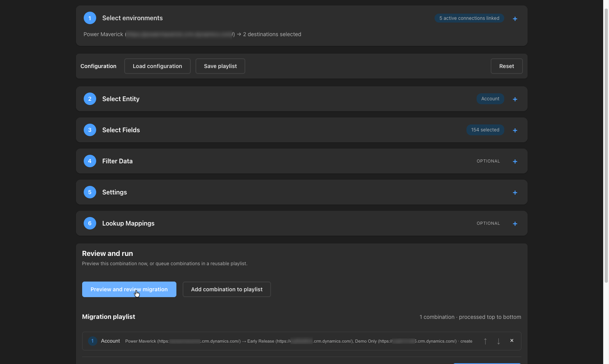

# Data Migrator

Migrate data from one Dataverse environment to another with intelligent auto-mapping and smart operations.

## Table of Contents

- [Data Migrator](#data-migrator)
    - [Table of Contents](#table-of-contents)
    - [UI Preview](#ui-preview)
    - [Features](#features)
    - [Installation](#installation)
    - [Development](#development)
    - [Usage in ToolBox](#usage-in-toolbox)
    - [Key Concepts](#key-concepts)
        - [Auto-Mapping](#auto-mapping)
        - [Migration Operations](#migration-operations)
        - [Lookup Field Handling](#lookup-field-handling)
    - [Technical Stack](#technical-stack)
    - [Configuration](#configuration)
        - [Migration Playlists](#migration-playlists)
        - [Multiple Destinations and Mapping](#multiple-destinations-and-mapping)
        - [Filter Options](#filter-options)
        - [Batch Settings](#batch-settings)
    - [Troubleshooting](#troubleshooting)
        - [Migration Fails](#migration-fails)
        - [Lookup Mapping Issues](#lookup-mapping-issues)
        - [Performance Issues](#performance-issues)
        - [Connection Issues](#connection-issues)
    - [Best Practices](#best-practices)
    - [Contributing](#contributing)
    - [License](#license)
    - [Support](#support)

## UI Preview



## Features

- ✅ React 18 with TypeScript
- ✅ Vite for fast development and optimized builds
- ✅ Auto-mapping of users, teams, and business units between environments
- ✅ Smart migration operations: Create, Update, Upsert, Delete
- ✅ Field selection and filtering (OData and FetchXML)
- ✅ Real-time progress tracking with detailed statistics
- ✅ Batch processing for large data sets (1-100 records per batch)
- ✅ Preview before migration to verify operations
- ✅ Lookup field mapping and transformation
- ✅ Modern Fluent UI with responsive design
- ✅ Step-based workflow with collapsible sections
- ✅ Confidence-level indicators for auto-mapping results
- ✅ Ordered migration playlists with per-entity settings and import/export
- ✅ Any assigned connection can be the source, with one to five selected destinations per entry
- ✅ Repeated entities and different source/destination combinations in one playlist
- ✅ Final confirmation with environment URLs, operations, and selected record count before writing

## Installation

Install dependencies:

```bash
npm install
```

## Development

Run development server:

```bash
npm run dev
```

Build for production:

```bash
npm run build
```

Run the focused connection-routing and mapping regression tests:

```bash
npm test
```

Preview production build:

```bash
npm run preview
```

### Publishing

The [Publish Data Migrator workflow](../../.github/workflows/publish-data-migrator.yml) installs dependencies, builds, tests, and publishes `@power-maverick/tool-data-migrator` publicly to npm when a pull request is merged into `main`. Update the package version before merging a release; npm does not allow publishing the same version twice.

Configure an npm trusted publisher for this package using the `Power-Maverick/PPTB-Tools` repository and the `publish-data-migrator.yml` workflow filename. The workflow uses OIDC rather than a stored npm token.

## Usage in ToolBox

1. Build the tool:

    ```bash
    npm run build
    ```

2. The built files will be in the `dist/` directory:
    - `index.html` - Main entry point
    - `index.js` - Bundled application
    - `index.css` - Compiled styles

3. Install the tool in Power Platform ToolBox through the UI

4. Use **Power Platform ToolBox 1.2.7 or newer** and assign between two and six connections.
    - Choose any assigned connection as the source; connection 1 is only the initial default.
    - Select one to five other environments as destinations. The source cannot also be a destination.
    - The environment panel shows the actual number of linked connections and the selected destination count separately.
    - PPTB connection changes refresh automatically; **Refresh connections** is also available. Preview again after an update.

5. Open Data Migrator and follow the step-by-step workflow:
    - Start at **1 Select environments**, then select the entity in Step 2 and configure fields, filters, settings, and lookups in the following steps. The environment step collapses to a source/destination summary when you configure the entity; reopen it to change the combination.
    - Choose fields to include
    - Apply filters (OData or FetchXML)
    - Select migration operation (Create/Update/Upsert/Delete)
    - Auto-map system entities (optional)
    - In **Review and run** below the configuration steps, preview the current combination or choose **Create playlist**, then **Add combination to playlist**
    - Repeat for each entity/environment combination and use the playlist arrows to set processing order
    - Choose **Save playlist** in the configuration toolbar to reuse the ordered configuration
    - Choose **Start playlist** inside the playlist panel; each entry still requires preview and confirmation
    - Choose **Preview and review migration** and select records
    - Review the source, destination URLs, operations, and record count; choose **Confirm and start migration**
    - Monitor progress and results per destination

## Key Concepts

### Auto-Mapping

The tool automatically maps system entities between source and target environments:

- **Users**: Matched by domain name, email address, or full name
- **Teams**: Matched by name and team type
- **Business Units**: Matched by name

Each mapping includes a confidence level (high, medium, low) based on the matching criteria used. Always review auto-mapping results before starting migration.

### Migration Operations

Choose the operation that fits your scenario:

- **Create**: Insert new records only (fails if record exists)
- **Update**: Update existing records by primary key (requires records to exist)
- **Upsert**: Insert if new, update if exists
- **Delete**: Remove records from target environment by matching primary key

### Lookup Field Handling

Configure how lookup fields are processed during migration:

- **Auto-Map**: Automatically map system entities (users, teams, business units)
- **Skip**: Exclude the lookup field from migration
- **Custom Mapping**: Define custom lookup transformations

## Technical Stack

- **React 18** with TypeScript
- **Fluent UI React Components** for modern, accessible UI
- **Vite** for fast development and optimized production builds
- **PPTB API** for all Dataverse operations
- **@pptb/types** - PPTB type definitions

## Configuration

### Migration Playlists

The **Review and run** section below the configuration steps keeps the preview action, playlist controls, and playlist entries together. Choose **Create playlist**, then configure an entity and select **Add combination to playlist**. New entries appear immediately below these controls, without jumping back to the top of the page. Every click appends a separate entry, even for the same entity. Each entry keeps its source, selected destinations, field mappings, lookup mappings, filter, operations, auto-mapping preference, and batch size. Different entries can use different sources.

Select an existing entry to edit it and choose **Update entry** to replace that entry, or **Add combination to playlist** to append a copy. Use the up/down buttons to reorder entries. **Load configuration**, **Save configuration/playlist**, and **Reset** are grouped separately from execution actions.

Preview and playlist actions are grouped on the left, in workflow order. Errors remain sticky at the top while scrolling. If a playlist's saved source or destination is no longer linked, affected entries are highlighted and a warning beside **Start playlist** identifies them. Starting is disabled until the connections are relinked or the affected entries are replaced or removed; relinking clears the warning automatically.

**Start playlist** prepares the first entry without writing any records. Preview and confirm each entry before it runs; the next entry is loaded only after all selected destinations succeed. **Stop playlist** stops the sequence between entries. Destinations run sequentially in selection order. Any record or setup failure stops the remaining destinations and playlist entries. Successful writes are not rolled back; review per-destination results before retrying.

Saved files use version 2.0 and store connection IDs, not slot numbers or credentials. IDs are resolved against the current slot assignments, preserving empty slots. Unavailable connections block execution instead of silently redirecting it. Older single-entity and playlist files without connection IDs use the currently selected source and destinations when imported; review these before confirming a run.

### Multiple Destinations and Mapping

System auto-mapping is rebuilt independently for every destination when enabled. The mapping preview shows the first selected destination only; mappings from that preview are never reused for other destinations. Manual lookup IDs apply to all destinations in that entry. Use separate playlist entries when destinations require different manual mappings.

The final confirmation lists all selected destinations, including their URLs, and explicitly warns about delete operations. Cancel or return to preview without changing data. Only selected preview records are migrated; OData preview is limited to 100 records. Connection assignments are checked again before preview and before each destination starts.

PPTB `connection:updated`, `connection:created`, and `connection:deleted` events automatically refresh the assigned slots and linked connection count. Existing playlist entries are retained. Connections that are no longer linked are removed from the current selection; stale metadata, mapping previews, record previews, and pending confirmations are invalidated. If an update occurs during migration, an already-started request may finish, but subsequent writes, destinations, and playlist entries are stopped. Connections refresh after the run stops, and completed changes are not rolled back. Preview and confirm again before retrying.

### Filter Options

- **OData Filters**: Use OData syntax for simple filtering
    - Example: `statecode eq 0 and createdon gt 2024-01-01`
- **FetchXML Queries**: Use complete FetchXML for complex queries
    - Supports advanced filtering, joins, and aggregations

### Batch Settings

- **Batch Size**: Control batch size for optimal performance (default: 50, max: 100 records)
- **Progress Tracking**: Real-time monitoring with statistics (total, successful, failed, skipped)

## Troubleshooting

### Migration Fails

**Issue**: Migration operation fails with entity or field errors

**Solution**:

- Verify target environment has the same entity/field structure as source
- Check that required fields have values in source data
- Review error messages in the progress panel
- Ensure user has appropriate permissions in both environments

### Lookup Mapping Issues

**Issue**: Lookups are not being mapped correctly between environments

**Solution**:

- Run auto-mapping before starting migration
- Verify users/teams/business units exist in target environment
- Check that entity and field names match between environments
- Verify the primary key values exist in target

### Performance Issues

**Issue**: Migration is slow or times out

**Solution**:

- Reduce batch size (try 25-50 records per batch)
- Use filters to migrate fewer records at once
- Check network connectivity and Dataverse performance
- Monitor server-side logs for throttling

### Connection Issues

**Issue**: Cannot connect to a selected environment

**Solution**:

- Verify the selected source and destination connections are assigned in PPTB
- Connection updates refresh automatically; use **Refresh connections** to retry if needed, then preview again
- Check that connection has appropriate Dataverse permissions
- Ensure both source and target environments are accessible
- Verify credentials have not expired

## Best Practices

1. **Test First**: Always test with a small data set first
2. **Use Filters**: Use OData/FetchXML filters to migrate specific records
3. **Review Mappings**: Verify auto-mapping results before starting migration
4. **Batch Processing**: Use appropriate batch sizes (50-100 records)
5. **Backup First**: Always backup target environment before migration
6. **Monitor Progress**: Watch for errors and statistics during migration
7. **Verify Results**: Spot-check migrated records in target environment

## Contributing

Contributions are welcome! When contributing:

1. Maintain PPTB integration patterns
2. Keep webview bundle browser-only (no Node.js dependencies)
3. Test in Power Platform ToolBox
4. Update documentation as needed
5. Follow existing code style

## License

This project is licensed under the GPL-2.0 License - see the [LICENSE](../../LICENSE) file for details.

## Support

- **Issues**: [GitHub Issues](https://github.com/Power-Maverick/PPTB-Tools/issues)
- **Discussions**: [GitHub Discussions](https://github.com/Power-Maverick/PPTB-Tools/discussions)
